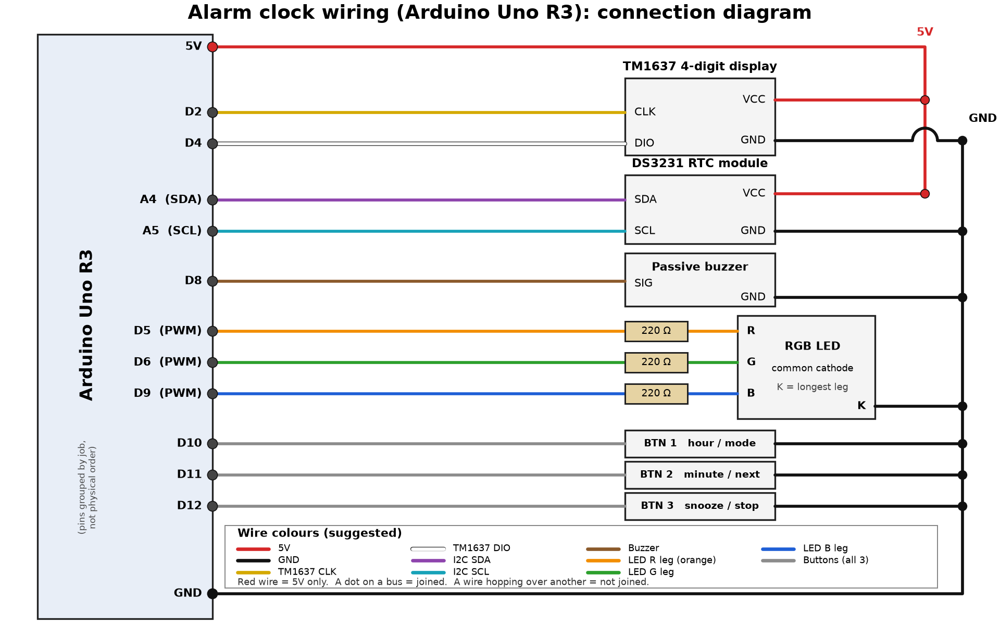
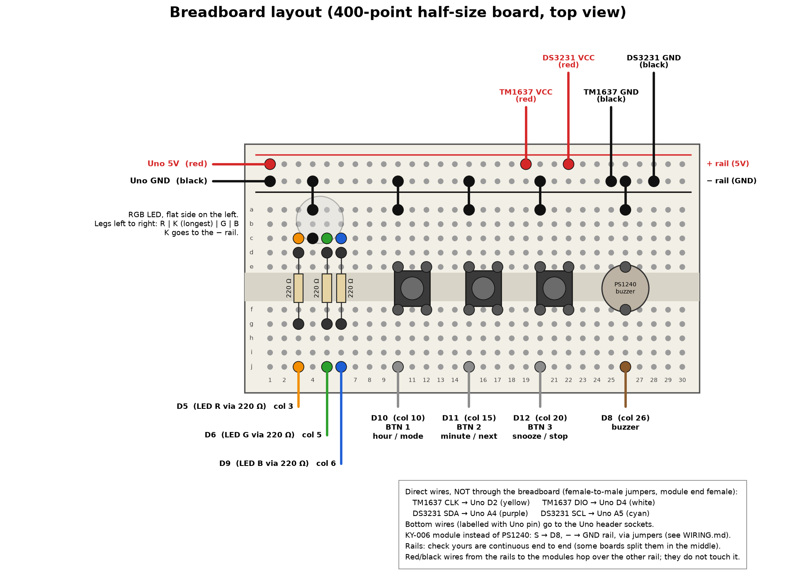

# Alarm clock: wiring plan

UNSW computer engineering society, beginner Arduino workshop. The clocks are pre-built, attendees change the code (display, LED colours, buzzer sounds). This file is the build and troubleshooting reference.

Status: **calculated and reviewed from datasheet/forum figures, not verified on hardware.** Build one clock first and run the checks in section 8 before building the rest.

Files: `wiring.png` / `wiring.svg` (connection diagram), `breadboard.png` / `breadboard.svg` (breadboard layout), `pins.h` (same pin names for code), `make_diagrams.py` (regenerates the diagrams: `uv run --with matplotlib python make_diagrams.py`).

---

## 1. Verdict on the proposed pin plan

The plan works. **No pins were changed.** What was checked:

| Check | Result |
|---|---|
| PWM pins D5, D6, D9 | All three are hardware PWM pins on the Uno R3 (PWM pins: 3, 5, 6, 9, 10, 11). D5 and D6 run off Timer0, D9 off Timer1. |
| `tone()` timer conflict | On the Uno, `tone()` uses Timer2, which breaks `analogWrite()` on D3 and D11 only. The LED uses D5/D6/D9, so it is unaffected. D11 is used as a plain digital *input* (button), which is fine. Rule for modifiers: never `analogWrite()` D3 or D11. |
| Other timer traps | `Servo.h` uses Timer1 (kills PWM on D9 and D10). Not used here, but tell anyone who adds a servo. |
| TM1637 on D2/D4 | The TM1637 uses its own 2-wire protocol, not I2C, so any two digital pins work. Do **not** put it on A4/A5. |
| DS3231 on A4/A5 | Correct: A4 = SDA, A5 = SCL on the Uno R3 (they are also the two extra pins near AREF). |
| Buttons on D10/D11/D12 | Fine as inputs with `INPUT_PULLUP` (internal pull-up, roughly 20 to 50 kohm). D10 is the SPI chip-select pin, D11 SPI MOSI, D12 SPI MISO, but SPI is not used, so no conflict. |
| D13 and D0/D1 | Left free on purpose. D13 drives the on-board LED, D0/D1 are the USB serial (uploads fail if something loads them). |
| I2C pull-ups | The common DS3231 module boards carry their own pull-ups on SDA/SCL (commonly 4.7 kohm, marked `472`; **check yours**). So no external pull-ups are needed. The Arduino `Wire` library also turns on the weak internal pull-ups, which is harmless in parallel. |
| USB power budget | Estimated worst case (not measured): Uno about 50 mA, TM1637 at full brightness up to roughly 80 mA, RGB LED 30 mA (section 3), buzzer under 10 mA, DS3231 module a few mA. About 170 to 180 mA total, well under the 500 mA a USB 2.0 port provides. Fine from a laptop or powered hub. |
| Pin current | LED pins source 8 to 14 mA each (section 3). ATmega328P: 40 mA absolute max per I/O pin (damage point), 20 mA is the test condition and the sensible design limit. Both met. |

---

## 2. Pin-by-pin connection table

All voltages are 5 V logic. Wire colours are suggestions (the diagrams use them); **red = 5 V and black = GND are the only strict ones.**

### 2a. Direct jumpers, module to Uno (female-to-male jumper: female end on the module header, male end into the Uno socket)

| From | To (Uno) | Wire colour | Notes |
|---|---|---|---|
| TM1637 CLK | D2 | yellow | |
| TM1637 DIO | D4 | white | |
| DS3231 SDA | A4 | purple | |
| DS3231 SCL | A5 | cyan or grey | cyan in the diagram |

Read each module's silkscreen: header order (CLK, DIO, VCC, GND on most TM1637 boards; SCL, SDA, VCC, GND on most DS3231 boards) is **not** the same on every board.

### 2b. Power distribution

| From | To | Colour |
|---|---|---|
| Uno 5V | breadboard `+` rail, hole at column 1 | red |
| Uno GND (any GND socket) | breadboard `-` rail, hole at column 1 | black |
| `+` rail, column 19 | TM1637 VCC | red |
| `+` rail, column 22 | DS3231 VCC | red |
| `-` rail, column 25 | TM1637 GND | black |
| `-` rail, column 28 | DS3231 GND | black |

### 2c. Parts on the breadboard

| Part | Breadboard holes | Other end | Colour |
|---|---|---|---|
| RGB LED, red leg | c3 | resistor R1, d3 to g3 (220 ohm); jumper j3 to Uno **D5** | orange |
| RGB LED, common (longest leg) | c4 | jumper a4 to `-` rail | black |
| RGB LED, green leg | c5 | resistor R2, d5 to g5 (220 ohm); jumper j5 to Uno **D6** | green |
| RGB LED, blue leg | c6 | resistor R3, d6 to g6 (220 ohm); jumper j6 to Uno **D9** | blue |
| Button 1 (hour / mode) | straddles trench, legs in e10, e12, f10, f12 | jumper a10 to `-` rail; jumper j10 to Uno **D10** | black / grey |
| Button 2 (minute / next) | e15, e17, f15, f17 | jumper a15 to `-` rail; jumper j15 to Uno **D11** | black / grey |
| Button 3 (snooze / stop) | e20, e22, f20, f22 | jumper a20 to `-` rail; jumper j20 to Uno **D12** | black / grey |
| Buzzer PS1240 (bare piezo) | straddles trench: one leg e26, other leg f26 | jumper a26 to `-` rail; jumper j26 to Uno **D8** | black / brown |

### 2d. Complete pin summary

| Uno pin | Goes to | `pins.h` name |
|---|---|---|
| D2 | TM1637 CLK | `PIN_TM_CLK` |
| D4 | TM1637 DIO | `PIN_TM_DIO` |
| A4 | DS3231 SDA | `PIN_I2C_SDA` |
| A5 | DS3231 SCL | `PIN_I2C_SCL` |
| D8 | Buzzer signal | `PIN_BUZZER` |
| D5 (PWM) | LED red via 220 ohm | `PIN_LED_R` |
| D6 (PWM) | LED green via 220 ohm | `PIN_LED_G` |
| D9 (PWM) | LED blue via 220 ohm | `PIN_LED_B` |
| D10 | Button 1 to GND | `PIN_BTN_HOUR` |
| D11 | Button 2 to GND | `PIN_BTN_MINUTE` |
| D12 | Button 3 to GND | `PIN_BTN_SNOOZE` |
| 5V | `+` rail (TM1637 VCC, DS3231 VCC) | |
| GND | `-` rail (everything else) | |

### 2e. Buzzer variants

* **TDK PS1240 (bare piezo, two legs):** as in the table. A piezo element is not polarity sensitive in practice; either way round works. Connect it straight to the pin, no resistor needed.
* **KY-006 module (3 pins):** do not plug it into the breadboard, use three female-to-male jumpers. **S** (signal) to D8 directly, **-** to the `-` rail. The middle pin is commonly unused on this style of module, so leave it unconnected, but check your module's silkscreen and confirm with a multimeter before assuming. I have not opened a KY-006 datasheet here.
* **Passive, not active:** the code uses `tone()`, which needs a passive buzzer. Quick test: touch a bare buzzer to 5V and GND. An active buzzer sounds continuously; a passive one only clicks. Some modules are mislabelled.

---

## 3. Resistor calculations (RGB LED)

Calculated, not measured. The LED needs one resistor **per colour leg** (they have different forward voltages, so a single shared resistor on the common leg would give uneven brightness and let the colours affect each other).

Given: Uno output 5 V (pin drops slightly under load, which only makes the real current lower). Typical forward voltages for a 5 mm RGB LED (typical values, **check your LED's datasheet**): red about 2.0 V, green about 3.0 to 3.3 V, blue about 3.0 to 3.3 V.

I = (V_supply - V_f) / R

| Colour | Vf (typ) | R | Current | Power in R |
|---|---|---|---|---|
| Red | 2.0 V | 220 ohm | (5 - 2.0) / 220 = **13.6 mA** | 3.0 V x 13.6 mA = 41 mW |
| Green | 3.2 V | 220 ohm | (5 - 3.2) / 220 = **8.2 mA** | 15 mW |
| Blue | 3.2 V | 220 ohm | (5 - 3.2) / 220 = **8.2 mA** | 15 mW |

* All well under the 1/4 W resistor rating, and under the 20 mA design limit per pin (40 mA absolute max).
* Worst-case margin: if a red LED had Vf = 1.8 V, I = 14.5 mA. The smallest safe resistor for 20 mA at 1.8 V is (5 - 1.8) / 20 mA = 160 ohm, so 220 ohm has margin.
* All three on (white): 13.6 + 8.2 + 8.2 = about **30 mA** total.
* **Use 220 ohm (red, red, brown, gold) for all three.** One value keeps the kit simple. Red looks a little brighter than green/blue at equal PWM, which is easy to adjust in code. Do not go below 150 ohm. If green/blue look dim in a bright room, 100 ohm on those two gives about 18 mA, which is near the limit, so only do it if you need to.
* The LED is *not* safe without resistors: direct from a pin it would try to pull far more than 40 mA.

**Added to the parts list: 3 x 220 ohm 1/4 W resistors per clock.**

### Common cathode or common anode? (identifying the LED)

The longest leg is the shared leg. It goes to GND for common cathode (CC, assumed here) or to 5V for common anode (CA).

1. Symptom in the finished clock: wired as CC, the LED stays dark or the colours are inverted (full-on shows dark, off shows bright). That means it is probably CA.
2. Direct test, no code: Uno on USB. Longest leg to GND, and one colour leg to 5V **through a 220 ohm resistor**. If it lights, it is CC. If it does not light, put the longest leg on 5V and the colour leg (through 220 ohm) to GND. If it lights now, it is CA.
3. Multimeter diode mode: if the red probe on the longest leg and black on a colour leg makes it glow (or reads about 1.8 to 3 V), it is CA. Reversed probes: CC. Some meters do not drive the blue/green die enough to glow, so use the red leg.

If you have a **common-anode** LED:
* Wiring change: move the jumper at a4 from the `-` rail to the `+` rail. Resistors and everything else stay as is. Current per colour is the same.
* Code change: PWM is inverted: `analogWrite(pin, 255 - value)`. In `pins.h` set `#define RGB_COMMON_ANODE 1` and always write `analogWrite(PIN_LED_R, RGB_LEVEL(value))`, which does the inversion for you.
* Leaving CA on a CC wiring (or vice versa) will not damage anything, because of the resistors.

---

## 4. DS3231 module and the CR2032 charging problem

Known issue (sources: EEVblog forum and Arduino forum threads on the ZS-042 board, onetransistor.eu write-up; these are community measurements, not a manufacturer datasheet): the popular ZS-042 style DS3231 module has a "charger" made of a **200 ohm resistor and a 1N4148 diode** from VCC to the battery holder, left over from using a rechargeable LIR2032. Powered from 5 V, it pushes about 4.3 to 4.4 V through 200 ohm into the battery continuously. A non-rechargeable **CR2032 must not be charged**: leaking, swelling or venting is possible. Many modules ship with a CR2032 anyway and mostly survive, but it is not safe design.

Do this on **every module before the battery goes in**:

1. Power the module from 5 V with **no battery fitted**.
2. Multimeter: battery holder `+` contact to GND. About 4.3 V or so means the charge circuit is present. About 0 V (or floating) means there is none and it is fine. Modules without a charge path exist; do not assume yours is one.
3. If present, choose one:
   * **Best for a workshop:** fit a **LIR2032** (rechargeable) instead of a CR2032 and leave the board alone. Note the 5 V charge voltage is a bit high for it (community suggestion: add a series diode on VCC, or just accept it for a short-lived workshop clock).
   * **Or disable the charger** with a CR2032: remove the 1N4148 diode, **or** the 200 ohm resistor (marked `201`), **or** cut the track between them. Do not cut the track from the battery to the DS3231 chip's battery pin. Afterwards check the module still answers on I2C with an I2C scanner (address 0x68), because one forum user lost communication after removing a part. If so, refit it and remove the diode instead.
   * Powering the module from 3.3 V also stops the charging, but is **not** recommended here: the Uno's I2C lines would then be pulled to 5 V by the Wire library's internal pull-ups, above what a 3.3 V part should see.
4. Fit the CR2032, `+` side up as marked in the holder.

---

## 5. Breadboard layout

400-point half-size board, 30 columns (1 to 30), rows a to e (top half) and f to j (bottom half). All five holes of one column in one half are joined; the two halves are **not** joined across the centre trench. Power rails run along the top. See `breadboard.png`.

* **Rails:** `+` row outer edge = 5 V (red), `-` row next to row a = GND (black). Follow the markings printed on *your* board; the order varies. Check the rails are continuous along the whole board (some boards split them mid-way). Uno 5V and GND enter at column 1.
* **Columns 3 to 6:** RGB LED legs in row c (R c3, long leg c4, G c5, B c6). Resistors vertical from row d to row g in columns 3, 5, 6, across the trench. Jumpers from row j to Uno D5, D6, D9. Jumper a4 to the `-` rail.
* **Columns 10-12, 15-17, 20-22:** one tactile button each, straddling the trench.
* **Column 26:** PS1240 piezo, legs in e26 and f26 (across the trench).
* **Columns 19, 22, 25, 28 on the rails:** the power feeds to the TM1637 and DS3231 modules.
* TM1637 and DS3231 signal wires skip the breadboard and go straight to the Uno.
* The modules themselves are not on the breadboard. They connect with female-to-male jumpers, so the module boards can sit anywhere in the enclosure/on the desk.

### Wire colour convention
| Colour | Use |
|---|---|
| **Red** | 5 V only. Nothing else, ever. |
| **Black** | GND only. |
| Yellow / white | TM1637 CLK / DIO |
| Purple / cyan (or grey) | I2C SDA / SCL |
| Brown | buzzer signal |
| Orange / green / blue | LED red leg / green leg / blue leg (LED red leg is orange so it is never mistaken for a 5 V wire) |
| Grey | the three button signal wires |

Real jumper packs differ; any colours are fine as long as red = 5 V and black = GND.

---

## 6. Build order (one person, about 15 minutes)

1. USB unplugged. Rails: Uno 5V to `+`, Uno GND to `-`.
2. LED, resistors, then its three jumpers and the GND jumper.
3. Buttons, then buzzer, then their jumpers.
4. TM1637 and DS3231 power from the rails, then their 4 signal wires direct to the Uno.
5. Check against the diagram, one wire at a time, **before** plugging in USB.
6. Plug in, upload, test each part.

---

## 7. Common mistakes and troubleshooting

**Display (TM1637)**
* Dark display: VCC and GND swapped or not connected (a swapped supply can also damage the module, so check before powering). CLK and DIO swapped just gives a blank or garbled display.
* Display works but flickers/shows nonsense: loose jumper on CLK/DIO; reseat. Try a lower brightness setting if the USB supply is weak.

**RTC (DS3231)**
* Time resets every power cycle: battery missing/flat/upside down, or in section 4 the charge circuit was disabled in the wrong place.
* "RTC not found": SDA/SCL swapped (A4 = SDA, A5 = SCL), no VCC/GND, or a dead module. Run an I2C scanner. Expect 0x68 (and maybe 0x57 for the on-board EEPROM).
* Time wrong by a lot: the code only sets the time when needed, so set it once with the compile time or a button routine.

**LED**
* Never lights: it is common-anode (section 3), the long leg is not on GND, or resistors are in the wrong column (resistor must sit between the LED leg's strip and the jumper strip, across the trench).
* Colours inverted: common anode, use `RGB_LEVEL()`.
* One colour missing: that leg's resistor is not bridging the trench, or its jumper is in the wrong column.
* Very dim: a 10 kohm or 1 kohm resistor was used by mistake. Check the bands: red, red, brown, gold = 220 ohm.

**Buttons**
* Always reads pressed: button is rotated 90 degrees (the two legs on the same side are internally joined, so rotated it shorts the strip). Rotate it so it straddles the trench with legs in two different columns.
* Never reads pressed: GND jumper missing, or `pinMode(..., INPUT_PULLUP)` not set (a plain `INPUT` floats).
* Presses count twice: contact bounce, add 20 to 50 ms debounce in code.

**Buzzer**
* Silent: active buzzer fitted (see section 2e), signal not on D8, or the code is not calling `tone()`. A bare piezo is quiet by nature; it is loudest around its resonant frequency (check the PS1240 datasheet for it).
* If someone adds PWM on D3 or D11 and it glitches while the buzzer plays: `tone()` takes Timer2.

**Whole thing**
* Nothing works / board resets / USB drops: a short between 5 V and GND (red touching black, a leg bridging rails). Unplug immediately.
* Upload fails: something connected to D0/D1. Not used in this plan, so check nobody added a wire there.
* Weird behaviour when everything lights up: a poor USB port or long thin cable. Try another cable/port.
* **Safety:** never connect 5 V to GND directly, never feed 5 V into a 3.3 V pin, and unplug USB before changing wiring. Never charge a CR2032 (section 4). The whole project runs from USB 5 V, no mains and no batteries other than the coin cell.

---

## 8. Tests to confirm the build (what to measure)

With a multimeter, USB plugged in, nothing else changed:
1. Rail `+` to `-`: about 5 V (4.7 to 5.2 V).
2. DS3231 VCC to GND and TM1637 VCC to GND: same reading as above.
3. Battery holder test from section 4 (before battery).
4. I2C scanner sketch: expect address 0x68.
5. LED test: each colour on alone, then all three. Total USB current is not expected to exceed about 200 mA.
6. Button test: serial print of the three pin states, pressed = LOW.
7. Buzzer test: `tone(PIN_BUZZER, 2000, 200)`.
